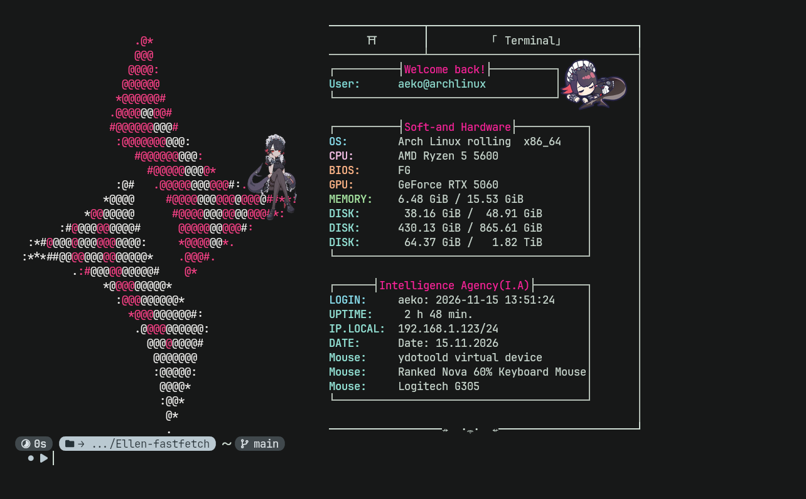

<div align="center">

🇬🇧 English · [🇫🇷 Français](README.md)

# Ellen-fastfetch

**A fastfetch setup themed after Ellen Joe (Zenless Zone Zero), for kitty + fish.**
ASCII logo, text frames, and Ellen images overlaid on top of your terminal.



</div>

---

## What you get

- A pink and white **ASCII logo** shaped like a star.
- Three **frames**: *Welcome back!*, *Soft-and Hardware* (OS, CPU, BIOS, GPU, RAM, disks) and *Intelligence Agency* (login, uptime, local IP, date, mouse).
- Two **Ellen images** drawn over the text. They reposition themselves depending on your window size and redraw when you resize it.
- Everything shows up **every time you open a terminal**.

---

## Quick install

Requirements: [kitty](https://sw.kovidgoyal.net/kitty/), [fish](https://fishshell.com/) and [fastfetch](https://github.com/fastfetch-cli/fastfetch). On Arch Linux:

```bash
sudo pacman -S kitty fish fastfetch
```

Then copy and paste:

```bash
git clone https://github.com/AEKO-kl/Ellen-fastfetch.git
cd Ellen-fastfetch

mkdir -p ~/.config/fastfetch ~/.config/fish/conf.d
cp -r Ellenconfig.jsonc Terminal_Ellen ~/.config/fastfetch/
cp ellen-fastfetch.fish ~/.config/fish/conf.d/
```

Open a **new kitty terminal** running fish: fastfetch starts and Ellen shows up.

> These commands only overwrite `Ellenconfig.jsonc`, the `Terminal_Ellen/` folder and `ellen-fastfetch.fish`. The rest of your config is left untouched.

### Your shell isn't fish?

Two options:

- Just type `fish` in kitty to try it out.
- Or make fish your default shell: `chsh -s /usr/bin/fish` (you need to log out and back in).

### Try it without fish or images

The fastfetch text output works in any terminal:

```bash
fastfetch -c ~/.config/fastfetch/Ellenconfig.jsonc
```

The Ellen images, however, only display in **kitty** (they rely on `kitten icat`).

### Uninstall

```bash
rm ~/.config/fish/conf.d/ellen-fastfetch.fish
rm ~/.config/fastfetch/Ellenconfig.jsonc
rm -r ~/.config/fastfetch/Terminal_Ellen
```

---

## Font

The frames use box-drawing characters (┌ ─ ┐ │ └ ┘) and the ⛩ symbol. Use a **monospace** font that supports them, preferably a [Nerd Font](https://www.nerdfonts.com/) (for example JetBrains Mono Nerd Font). Without one, the borders may be misaligned.

---

## Repository contents

```
Ellen-fastfetch/
├── Ellenconfig.jsonc        # fastfetch config (frames, modules, colors)
├── ellen-fastfetch.fish     # launches fastfetch + places the images
├── Terminal_Ellen/
│   ├── ascii-etoile.txt     # colored ASCII logo
│   ├── Ellen2-trim.png      # Ellen image (top right)
│   ├── sitpose-trim.png     # Ellen sitting on the frame
│   └── ...                  # other available images
├── screenshots/
│   └── preview.png
├── README.md                # French
└── README.en.md             # English
```

---

## Adjusting the images

The images are placed by hand for three window sizes. The settings are at the top of `~/.config/fish/conf.d/ellen-fastfetch.fish`.

To find your terminal size (rows then columns):

```bash
stty size
```

### The three modes

| Mode | Condition |
|---|---|
| `big` (fullscreen) | columns ≥ 150 **and** rows ≥ 40 |
| `mid` (medium) | columns ≥ 101 **and** rows ≥ 37 |
| `small` | everything else |

You can change the thresholds with `big_cols`, `big_rows`, `mid_cols` and `mid_rows`.

### Settings for one image

For each image (here `ellen`) and each mode (`big`, `mid`, `small`):

```fish
set -g ellen_big_x 79   # horizontal position (columns from the left)
set -g ellen_big_y 1    # vertical position (rows from the top)
set -g ellen_big_w 26   # maximum width
set -g ellen_big_h 7    # maximum height
```

- `x`, `y`: a **negative** number sticks the image to the right or bottom edge (`-1` = flush, `-3` = 2-cell margin).
- `w`, `h`: maximum size, the image keeps its proportions.
- `ellen_z` / `sitpose_z`: `1` or more draws the image **above** the text, `-1` **behind** it.

After changing a setting, open a new terminal (or resize the window) to see the result.

---

## Adding your own image

1. Copy your PNG (transparent background, cropped tightly) into `~/.config/fastfetch/Terminal_Ellen/`.
2. Add a prefix to the list (the last image is drawn on top):
   ```fish
   set -g overlay_images ellen sitpose myimage
   ```
3. Add a settings block using that prefix:
   ```fish
   # ---------- My image ----------
   set -g myimage_img ~/.config/fastfetch/Terminal_Ellen/my-image.png
   set -g myimage_z 1
   set -g myimage_big_x 10
   set -g myimage_big_y 5
   set -g myimage_big_w 20
   set -g myimage_big_h 8
   set -g myimage_mid_x 10
   set -g myimage_mid_y 5
   set -g myimage_mid_w 15
   set -g myimage_mid_h 6
   set -g myimage_small_x 5
   set -g myimage_small_y -3
   set -g myimage_small_w 12
   set -g myimage_small_h 5
   ```

---

## Customizing the text

Everything happens in `~/.config/fastfetch/Ellenconfig.jsonc`.

| What you want to change | Where |
|---|---|
| The ASCII logo | the file `Terminal_Ellen/ascii-etoile.txt`, or the `"source"` line |
| The pink of the titles | `{##FA239B}` in the `custom` lines |
| The label colors (OS, CPU...) | `"keyColor"` of each module |
| The frame color | `{#90}` (gray) in the `format` strings |
| The displayed modules | the `"modules"` list (see `fastfetch --list-modules`) |
| The "Terminal" title | the `「Terminal」` line at the top of the file |

> The frames are drawn by hand with spaces. If you change a module, adjust the `<` and `>` in its `format` so the right border stays aligned.

---

## Troubleshooting

**The images don't show up.**
You must be in **kitty** (not another terminal, and not a TTY). Check that the PNG files exist in `~/.config/fastfetch/Terminal_Ellen/`, then test by hand:

```bash
kitten icat ~/.config/fastfetch/Terminal_Ellen/Ellen2-trim.png
```

**The ASCII logo doesn't show up.**
Check that `~/.config/fastfetch/Terminal_Ellen/ascii-etoile.txt` exists. If the `~` path isn't handled on your system, replace it with your full path on the `"source"` line of `Ellenconfig.jsonc` (for example `/home/your-name/.config/fastfetch/Terminal_Ellen/ascii-etoile.txt`).

**Nothing launches when I open the terminal.**
Make sure you are in fish (`echo $SHELL` or `fish`) and that the file is in place: `ls ~/.config/fish/conf.d/ellen-fastfetch.fish`.

**The images are misplaced.**
Check your window size with `stty size`, find the matching mode (`small`, `mid`, `big`) and adjust `x`, `y`, `w`, `h` for that mode.

**The frames are misaligned.**
Switch fonts, or shorten the value involved (CPU name, GPU name...) using `<` / `>` in the module's `format`.

**`Config introuvable` message.**
The name in `set -g fetch_mode Ellenconfig` must match a file `~/.config/fastfetch/<name>.jsonc`. (The message is in French: it means "config not found".)

---

## Credits

- [fastfetch](https://github.com/fastfetch-cli/fastfetch) for the tool.
- [kitty](https://sw.kovidgoyal.net/kitty/) and `kitten icat` for image display.
- Ellen Joe and *Zenless Zone Zero* belong to HoYoverse. The images are fan illustrations or game visuals, all rights reserved to their authors. If you are the author of an image and want it removed or credited, please open an issue.

---

<div align="center">

Made by [AEKO-kl](https://github.com/AEKO-kl) · A star ⭐ is always appreciated

</div>
