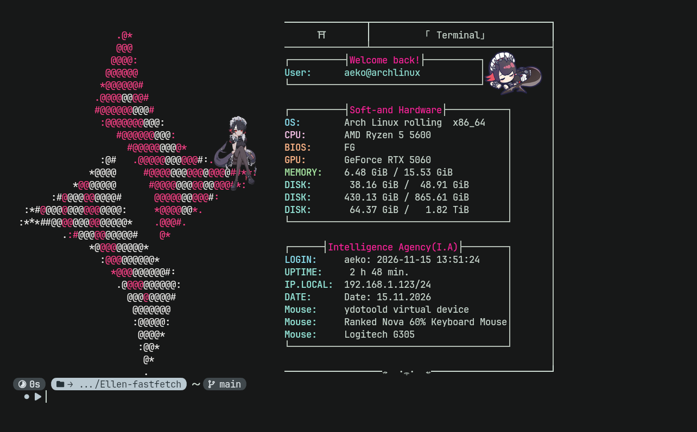

<div align="center">

[🇬🇧 English](README.en.md) · 🇫🇷 Français

# Ellen-fastfetch

**Un fastfetch aux couleurs d'Ellen Joe (Zenless Zone Zero) pour kitty + fish.**
Logo ASCII, cadres de texte, et des images d'Ellen posées par-dessus ton terminal.



</div>

---

## Ce que tu obtiens

- Un **logo ASCII** rose et blanc en forme d'étoile.
- Trois **cadres** : *Welcome back!*, *Soft-and Hardware* (OS, CPU, BIOS, GPU, RAM, disques) et *Intelligence Agency* (connexion, uptime, IP locale, date, souris).
- Deux **images d'Ellen** affichées par-dessus le texte, qui se replacent toutes seules selon la taille de la fenêtre et se redessinent quand tu la redimensionnes.
- Tout s'affiche **à l'ouverture de chaque terminal**.

---

## Installation rapide

Prérequis : [kitty](https://sw.kovidgoyal.net/kitty/), [fish](https://fishshell.com/) et [fastfetch](https://github.com/fastfetch-cli/fastfetch). Sur Arch Linux :

```bash
sudo pacman -S kitty fish fastfetch
```

Puis copie-colle :

```bash
git clone https://github.com/AEKO-kl/Ellen-fastfetch.git
cd Ellen-fastfetch

mkdir -p ~/.config/fastfetch ~/.config/fish/conf.d
cp -r Ellenconfig.jsonc Terminal_Ellen ~/.config/fastfetch/
cp ellen-fastfetch.fish ~/.config/fish/conf.d/
```

Ouvre un **nouveau terminal kitty** avec fish : fastfetch se lance et Ellen apparaît.

> Ces commandes n'écrasent que `Ellenconfig.jsonc`, le dossier `Terminal_Ellen/` et `ellen-fastfetch.fish`. Le reste de ta config n'est pas touché.

### Ton shell n'est pas fish ?

Deux options :

- Tape simplement `fish` dans kitty pour l'essayer.
- Ou fais de fish ton shell par défaut : `chsh -s /usr/bin/fish` (reconnexion nécessaire).

### Tester sans fish ni images

Le texte de fastfetch fonctionne dans n'importe quel terminal :

```bash
fastfetch -c ~/.config/fastfetch/Ellenconfig.jsonc
```

Les images d'Ellen, elles, ne s'affichent que dans **kitty** (elles utilisent `kitten icat`).

### Désinstaller

```bash
rm ~/.config/fish/conf.d/ellen-fastfetch.fish
rm ~/.config/fastfetch/Ellenconfig.jsonc
rm -r ~/.config/fastfetch/Terminal_Ellen
```

---

## Police

Les cadres utilisent des caractères de dessin (┌ ─ ┐ │ └ ┘) et le symbole ⛩. Utilise une **monospace** qui les gère, de préférence une [Nerd Font](https://www.nerdfonts.com/) (JetBrains Mono Nerd Font, par exemple). Sans cela, les bordures peuvent être décalées.

---

## Contenu du dépôt

```
Ellen-fastfetch/
├── Ellenconfig.jsonc        # config fastfetch (cadres, modules, couleurs)
├── ellen-fastfetch.fish     # lancement de fastfetch + placement des images
├── Terminal_Ellen/
│   ├── ascii-etoile.txt     # logo ASCII en couleur
│   ├── Ellen2-trim.png      # image d'Ellen (en haut à droite)
│   ├── sitpose-trim.png     # Ellen assise sur le cadre
│   └── ...                  # autres images disponibles
├── screenshots/
│   └── preview.png
├── README.md                # français
└── README.en.md             # anglais
```

---

## Régler les images

Les images sont placées à la main pour trois tailles de fenêtre. Les réglages sont en haut de `~/.config/fish/conf.d/ellen-fastfetch.fish`.

Pour connaître la taille de ton terminal (lignes puis colonnes) :

```bash
stty size
```

### Les trois modes

| Mode | Condition |
|---|---|
| `big` (plein écran) | colonnes ≥ 150 **et** lignes ≥ 40 |
| `mid` (moyenne) | colonnes ≥ 101 **et** lignes ≥ 37 |
| `small` | tout le reste |

Les seuils se changent avec `big_cols`, `big_rows`, `mid_cols` et `mid_rows`.

### Les réglages d'une image

Pour chaque image (ici `ellen`) et chaque mode (`big`, `mid`, `small`) :

```fish
set -g ellen_big_x 79   # position horizontale (colonnes depuis la gauche)
set -g ellen_big_y 1    # position verticale (lignes depuis le haut)
set -g ellen_big_w 26   # largeur maximale
set -g ellen_big_h 7    # hauteur maximale
```

- `x`, `y` : un nombre **négatif** colle l'image au bord droit ou bas (`-1` = collé, `-3` = marge de 2).
- `w`, `h` : taille maximale, l'image garde ses proportions.
- `ellen_z` / `sitpose_z` : `1` ou plus place l'image **au-dessus** du texte, `-1` **derrière**.

Après un réglage, ouvre un nouveau terminal (ou redimensionne la fenêtre) pour voir le résultat.

---

## Ajouter ta propre image

1. Copie ton PNG (fond transparent, recadré au plus près) dans `~/.config/fastfetch/Terminal_Ellen/`.
2. Ajoute un préfixe à la liste (la dernière image est dessinée au-dessus) :
   ```fish
   set -g overlay_images ellen sitpose monimage
   ```
3. Ajoute un bloc de réglages avec ce préfixe :
   ```fish
   # ---------- Mon image ----------
   set -g monimage_img ~/.config/fastfetch/Terminal_Ellen/mon-image.png
   set -g monimage_z 1
   set -g monimage_big_x 10
   set -g monimage_big_y 5
   set -g monimage_big_w 20
   set -g monimage_big_h 8
   set -g monimage_mid_x 10
   set -g monimage_mid_y 5
   set -g monimage_mid_w 15
   set -g monimage_mid_h 6
   set -g monimage_small_x 5
   set -g monimage_small_y -3
   set -g monimage_small_w 12
   set -g monimage_small_h 5
   ```

---

## Personnaliser le texte

Tout se passe dans `~/.config/fastfetch/Ellenconfig.jsonc`.

| Ce que tu veux changer | Où |
|---|---|
| Le logo ASCII | le fichier `Terminal_Ellen/ascii-etoile.txt`, ou la ligne `"source"` |
| Le rose des titres | `{##FA239B}` dans les lignes `custom` |
| La couleur des étiquettes (OS, CPU...) | `"keyColor"` de chaque module |
| La couleur des cadres | `{#90}` (gris) dans les `format` |
| Les modules affichés | la liste `"modules"` (voir `fastfetch --list-modules`) |
| Le titre « Terminal » | la ligne `「Terminal」` en haut du fichier |

> Les cadres sont dessinés à la main avec des espaces. Si tu changes un module, ajuste les `<` et `>` dans son `format` pour que la bordure de droite reste alignée.

---

## Problèmes courants

**Les images n'apparaissent pas.**
Tu dois être dans **kitty** (pas un autre terminal, ni un TTY). Vérifie que les PNG existent dans `~/.config/fastfetch/Terminal_Ellen/`, puis teste à la main :

```bash
kitten icat ~/.config/fastfetch/Terminal_Ellen/Ellen2-trim.png
```

**Le logo ASCII n'apparaît pas.**
Vérifie que `~/.config/fastfetch/Terminal_Ellen/ascii-etoile.txt` existe. Si le chemin avec `~` n'est pas pris en compte chez toi, remplace-le par ton chemin complet à la ligne `"source"` de `Ellenconfig.jsonc` (par exemple `/home/ton-nom/.config/fastfetch/Terminal_Ellen/ascii-etoile.txt`).

**Rien ne se lance à l'ouverture du terminal.**
Vérifie que tu es bien dans fish (`echo $SHELL` ou `fish`) et que le fichier est ici : `ls ~/.config/fish/conf.d/ellen-fastfetch.fish`.

**Les images sont mal placées.**
Relève la taille de ta fenêtre avec `stty size`, repère le mode correspondant (`small`, `mid`, `big`) et ajuste `x`, `y`, `w`, `h` pour ce mode.

**Les cadres sont décalés.**
Change de police, ou raccourcis la valeur concernée (nom du CPU, du GPU...) avec `<` / `>` dans le `format` du module.

**Message `Config introuvable`.**
Le nom dans `set -g fetch_mode Ellenconfig` doit correspondre à un fichier `~/.config/fastfetch/<nom>.jsonc`.

---

## Crédits

- [fastfetch](https://github.com/fastfetch-cli/fastfetch) pour l'outil.
- [kitty](https://sw.kovidgoyal.net/kitty/) et `kitten icat` pour l'affichage des images.
- Ellen Joe et *Zenless Zone Zero* appartiennent à HoYoverse. Les images sont des illustrations de fans ou des visuels du jeu, droits réservés à leurs auteurs. Si tu es l'auteur d'une image et souhaites qu'elle soit retirée ou créditée, ouvre une issue.

---

<div align="center">

Fait par [AEKO-kl](https://github.com/AEKO-kl) · Une étoile ⭐ fait toujours plaisir

</div>
